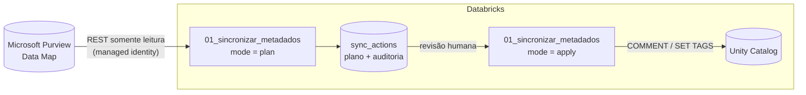

# Purview → Unity Catalog: migração de metadados

Automação para levar a **documentação** que o seu time construiu no **Microsoft Purview** para as tabelas migradas no
**Databricks Unity Catalog**, sem retrabalho manual.

**Fase 1:** cada tabela do UC é casada com o asset correspondente no Purview (Synapse dedicated/serverless). Depois,
copiamos:

| No Purview | No Unity Catalog |
|---|---|
| Descrição da tabela e das colunas (`userDescription`, ou `description` como fallback; HTML convertido para markdown) | `COMMENT` da tabela e das colunas |
| Classificações (`MICROSOFT.PERSONAL.EMAIL`, `MICROSOFT.GOVERNMENT.BRAZIL.CPF_NUMBER`, customizadas…) | Tags. Por padrão, as classificações nativas viram as **governed tags `class.*`** do Databricks Data Classification (`class.email_address`, `class.br_cpf`…) |
| Termos de glossário | Tags `purview_term_<termo> = 'Termo@Glossário'` |
| Labels | Tags `purview_label_<label>` |

Tudo roda em **notebooks Databricks** (serverless), sem secrets, e com **plano revisável antes de qualquer alteração**.



## Por que este desenho

| Decisão | Por quê |
|---|---|
| **Plan → revisão → apply** | Ninguém altera produção sem ver o diff. O plano fica numa tabela Delta, com o SQL exato de cada ação. |
| **Conservador por padrão** | Comentários e tags que alguém editou à mão no UC nunca são sobrescritos (`CONFLICT`). Tags só são adicionadas, nunca removidas. |
| **Reexecutável** | Rodar de novo só propõe o que mudou no Purview. Valores que a própria automação gravou podem ser atualizados (`PURVIEW_UPDATED`); edições manuais continuam protegidas. |
| **Checagem de drift** | O apply executa o plano *revisado*. Se o UC mudou depois do plano, a ação vira `DRIFTED` e não é aplicada. |
| **Service credential (managed identity)** | Sem secret para guardar ou rotacionar. O acesso ao Purview é governado por `GRANT ACCESS` no UC. |
| **De-para explícito (regex + CSV)** | Um match errado copiaria a classificação PII errada para a tabela errada. Cada mapeamento é revisável. |
| **Governed tags validadas no plano** | Valores fora da lista permitida aparecem no plano como `SKIPPED`, em vez de falhar no apply. |

Detalhes e alternativas descartadas: [docs/decisoes.md](docs/decisoes.md).

## Como usar

### 1. Pré-requisitos (uma vez)

Passo a passo com comandos: [docs/permissoes.md](docs/permissoes.md).

1. **Access Connector** (Azure) + **service credential** no UC, por exemplo `purview-reader`.
2. Papel **Data Reader** para a managed identity do connector nas collections do Purview que serão migradas.
3. Quem roda o notebook precisa de:
   - `ACCESS` na service credential;
   - `MODIFY` (comentários) e `APPLY TAG` (tags) nas tabelas de destino;
   - `ASSIGN` nas governed tags usadas (ex.: `class.*`).
4. Workspace com **serverless** habilitado e saída de rede para `https://<conta>.purview.azure.com`.

### 2. Trazer o repositório para o workspace

*Workspace → Create → Git folder* com a URL deste repositório. Alternativa: `databricks sync . /Workspace/Users/<você>/purview-unitycatalog-migration`.

### 3. Configurar

Edite [config/config.yaml](config/config.yaml): conta Purview, tipos de asset, regras de de-para e catálogo de controle.
Tabelas renomeadas na migração vão em [config/table_overrides.csv](config/table_overrides.csv).
Referência completa: [docs/mapeamento.md](docs/mapeamento.md).

### 4. Executar

| Passo | Notebook | O que acontece |
|---|---|---|
| a | `notebooks/00_inventario` | Somente leitura. Mostra os tipos de asset do Purview, a prévia do de-para e as tabelas sem par. Ajuste o config até o de-para ficar correto. |
| b | `notebooks/01_sincronizar_metadados` com `mode = plan` | Grava em `sync_actions` o plano, com o SQL de cada mudança. **Não altera nada.** |
| c | *Revisão* | Use as consultas no fim do notebook ou as de [Revisando o plano](#revisando-o-plano). Resolva os `CONFLICT` se quiser (ajustando o UC ou o `on_conflict`). |
| d | `notebooks/01_sincronizar_metadados` com `mode = apply` | Aplica o último plano (ou o `run_id` informado) e registra o resultado de cada ação. |

Rode de novo sempre que o Purview mudar, ou depois de recargas que recriam tabelas (`CREATE OR REPLACE` apaga os metadados).

### Revisando o plano

```sql
-- Resumo do último plano
SELECT action, status, reason, count(*) FROM <catalog>.purview_migration.sync_actions
WHERE run_id = (SELECT max(run_id) FROM <catalog>.purview_migration.sync_actions WHERE mode = 'plan') AND mode = 'plan'
GROUP BY ALL ORDER BY ALL;

-- O que será executado
SELECT uc_object, column_name, action, tag_key, current_value, desired_value, sql_statement
FROM <catalog>.purview_migration.sync_actions
WHERE run_id = '<run_id>' AND mode = 'plan' AND status = 'PLANNED';

-- Histórico completo de uma tabela (auditoria)
SELECT run_id, mode, created_at, action, column_name, tag_key, desired_value, status, reason, error
FROM <catalog>.purview_migration.sync_actions WHERE uc_object = 'catalogo.schema.tabela' ORDER BY created_at;
```

| `status` | Significado |
|---|---|
| `PLANNED` | Será aplicado no próximo `apply`. Com `reason = PURVIEW_UPDATED`, atualiza um valor que a própria automação gravou. |
| `CONFLICT` | O UC já tem outro valor, definido por alguém. Não é aplicado (veja `comments.on_conflict` / `tags.on_conflict`). |
| `SKIPPED` | Ignorado com motivo em `reason`: sem par (`NO_MATCH`), governed tag com valor não permitido, limite de 50 tags, MV/Streaming Table… |
| `APPLIED` / `FAILED` | Resultado do apply (`error` traz a mensagem). |
| `DRIFTED` | O UC mudou entre o plan e o apply; a ação não foi aplicada. Gere um novo plano. |

## Estrutura

```
config/          config.yaml (exemplo comentado) e table_overrides.csv
notebooks/       00_inventario, 01_sincronizar_metadados
purview2uc/      lógica (importada pelos notebooks)
  purview.py       REST do Purview: busca paginada, Atlas bulk, termos, retry
  matching.py      de-para regex + overrides, ambíguos, sem par
  transform.py     descrição (HTML→markdown), derivação/sanitização de tags
  presets.py       classificações Microsoft → governed tags class.* do Databricks
  planner.py       diff com o UC, conflitos, limites, drift (Python puro, testado)
  sql.py           SQL seguro (escaping de aspas e barras)
  uc.py            information_schema, execução paralela, tabelas de controle
  auth.py          service credential (ou secret scope)
demo/            ambiente de demonstração: seed do Purview e do UC, permissões, limpeza
docs/            decisões, permissões, mapeamento, roadmap
tests/           pytest com fixtures capturadas de um Purview real
```

## Demonstração (ambiente de teste reproduzível)

Monta um Synapse fictício no Purview, sem provisionar nem escanear um Synapse de verdade, e as tabelas "migradas" no UC,
com casos de borda propositais: HTML, aspas e barras na descrição, coluna removida, tabela renomeada, comentário e tag
pré-existentes, view, tabela só de um lado.

```bash
az login
python3 demo/seed_purview.py --account <conta-purview>          # requer Data Curator na collection raiz
python3 demo/grant_purview_reader.py --account <conta-purview> --principal-id <object-id-da-managed-identity>
python3 demo/run_sql_file.py demo/seed_uc.sql --profile <profile> --warehouse-id <id>   # cria p2uc_demo.*
```

Depois rode os notebooks com o `config/config.yaml` deste repo, que já aponta para a demo.
Para limpar: `python3 demo/cleanup.py --account <conta-purview>` e `DROP CATALOG p2uc_demo CASCADE`.

Resultado validado na demo:
- 1º apply: 55 ações aplicadas, 0 falhas.
- 2º plano: 0 ações (idempotente).
- Uma edição no Purview gera exatamente as ações correspondentes.
- Uma edição manual entre o plan e o apply vira `DRIFTED`.

## Testes

```bash
python3 -m venv .venv && .venv/bin/pip install pytest pyyaml requests
.venv/bin/python -m pytest -q
```

## Limitações conhecidas (Fase 1)

- **Rede:** Purview com private endpoint ou acesso público desativado não é alcançável pelo serverless. Use compute clássico com VNet injection, ou private endpoint via NCC.
- **Glossário:** apenas o glossário clássico (`meanings`). Termos do *Unified Catalog* (portal novo) usam outra API.
- **Sem lineage e sem ADLS resource sets.** Veja o [roadmap](docs/roadmap.md).
- **Colunas:** casadas pelo nome, sem diferenciar maiúsculas. Colunas renomeadas na migração aparecem como `COLUMN_NOT_IN_UC`.
- **Power BI:** o driver ODBC trunca comentários em 512 bytes por padrão.
- **Visibilidade:** `information_schema` só mostra o que o usuário enxerga. Rode com um principal que veja todos os catálogos de destino.
- **Sensibilidade:** o snapshot (`purview_snapshot`) pode conter descrições sensíveis; restrinja o acesso ao schema de controle.

Próximas fases: [docs/roadmap.md](docs/roadmap.md).
